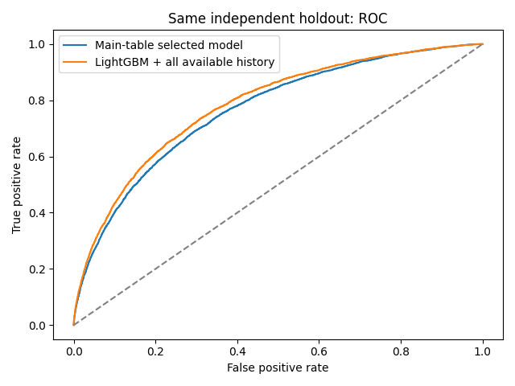
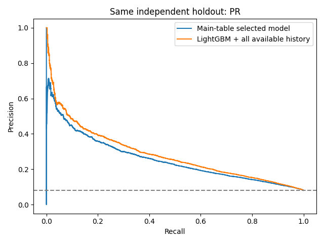
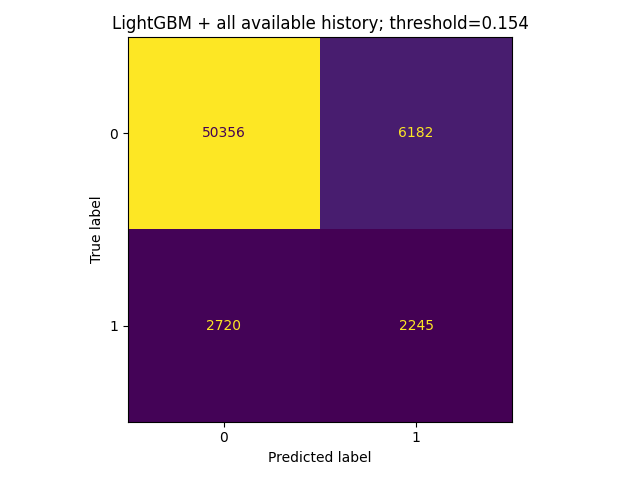
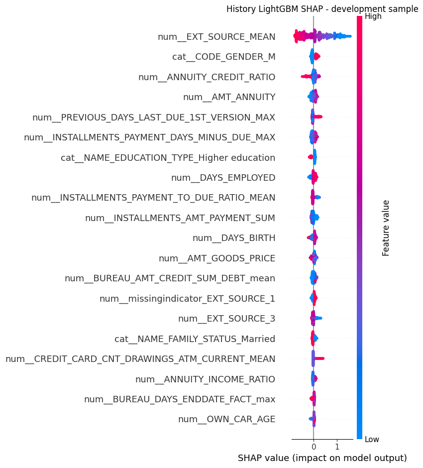

# Home Credit 贷款违约预测：完整真实数据项目

## 本次完成了什么
使用 application_train / application_test 主表，完成逻辑回归、随机森林、LightGBM 三模型比较；再加入 bureau 和 bureau_balance 做中间比较，最后整合全部成功上传的历史表训练完整历史版 LightGBM。
所有指标来自真实上传的数据，没有使用模拟样本，也没有抽取部分训练行来代替全量实验。

| 输入表 | 实际行数 |
|---|---:|
| application_train | 307,511 |
| application_test | 48,744 |
| bureau | 1,716,428 |
| bureau_balance | 27,299,925 |
| previous_application | 1,670,214 |
| installments_payments | 13,605,401 |
| credit_card_balance | 3,840,312 |
| POS_CASH_balance | 10,001,358 |

十份文件中，八份数据表用于训练或预测；另两份是字段说明与提交格式示例，不作为预测特征。

训练标签中约 8.07% 为还款困难；最终预留 holdout 为 61,503 行。
历史表生成 344 个特征，增强版共有 470 个原始/工程特征（编码和缺失指示前）。
有 3,120,184 条 bureau_balance 记录的 SK_ID_BUREAU 无法在提供的 bureau 中关联，已排除，不猜测归属。
历史余额按块读取，不把 2,730 万条月度记录直接合并到主表，以避免重复申请人和内存膨胀。

## 模型表现
| model                            |   selection_cv_auc |   fold_auc_std |   holdout_auc |   holdout_average_precision |
|:---------------------------------|-------------------:|---------------:|--------------:|----------------------------:|
| LightGBM + all available history |            0.77920 |        0.00209 |       0.78224 |                     0.28377 |
| LightGBM + bureau history        |            0.76603 |        0.00049 |       0.76905 |                     0.26771 |
| LightGBM                         |            0.76075 |        0.00002 |       0.76490 |                     0.25650 |
| Logistic regression              |            0.74918 |        0.00158 |       0.75207 |                     0.23776 |
| Random forest                    |            0.74009 |        0.00160 |       0.74431 |                     0.23117 |

按开发集 CV AUC 选择 **LightGBM + all available history**，最终提交预测文件是 `output/submission.csv`。
加入历史表后，相比主表 LightGBM，CV AUC 变化为 +0.01845，独立 holdout AUC 变化为 +0.01735。
这是固定 seed、固定一次拆分下的结果，不是统计显著性检验。

## 怎样避免验证泄漏
所有实验使用同一 80/20 分层拆分，种子 42。
三个主表模型和历史增强版均使用开发集三折分层 CV；填补、编码、标准化仅在训练折拟合。
主表和增强版 LightGBM 使用相同的树数、学习率及参数网格，方便比较历史特征的作用。
历史聚合只用提供的历史记录和 ID，不用 TARGET；假设竞赛历史记录在申请时已可用，并未实施另一个真实时间截断实验。
按 CV 选择模型，按开发集 OOF 最大 F1 选阈值；holdout 不用于调参和选阈值。
CV 和 OOF 被用于选择，因此有乐观偏差；holdout 作为独立评估。不能再根据这份 holdout 报告继续调参。

## 增强版阈值与误判
开发集阈值 0.15417；holdout precision=0.2664，recall=0.4522，F1=0.3353。

| error_type     |   applicants |   mean_probability |   mean_income |   mean_credit |   mean_ext_source_2 |
|:---------------|-------------:|-------------------:|--------------:|--------------:|--------------------:|
| correct        |   52601.0000 |             0.0624 |   170145.7753 |   607538.3655 |              0.5369 |
| false_negative |    2720.0000 |             0.0804 |   165687.3116 |   600948.6551 |              0.4972 |
| false_positive |    6182.0000 |             0.2390 |   156498.9109 |   513324.8524 |              0.3339 |

false_negative 是实际还款困难却未检出，false_positive 是没有该标签却被判为高风险。
这些均值只是错误诊断，可能受极端值与混杂因素影响；不代表因果关系或客户群体的固有风险。
最大 F1 的阈值并未纳入放贷利润或违约损失，不能直接当业务决策阈值。

## 图表与解释

增强版 LightGBM 在开发集抽样上的 mean absolute SHAP 前十名：
|                                              |   mean_abs_SHAP |
|:---------------------------------------------|----------------:|
| num__EXT_SOURCE_MEAN                         |         0.49938 |
| cat__CODE_GENDER_M                           |         0.08442 |
| num__ANNUITY_CREDIT_RATIO                    |         0.07778 |
| num__AMT_ANNUITY                             |         0.07077 |
| num__PREVIOUS_DAYS_LAST_DUE_1ST_VERSION_MAX  |         0.06964 |
| num__INSTALLMENTS_PAYMENT_DAYS_MINUS_DUE_MAX |         0.06723 |
| cat__NAME_EDUCATION_TYPE_Higher education    |         0.06017 |
| num__DAYS_EMPLOYED                           |         0.05816 |
| num__INSTALLMENTS_PAYMENT_TO_DUE_RATIO_MEAN  |         0.05773 |
| num__INSTALLMENTS_AMT_PAYMENT_SUM            |         0.05592 |

SHAP 横轴解释树模型的原始输出贡献，不是概率百分点；红色表示特征值高，蓝色表示低。
平均绝对值大表示模型更依赖该特征，不说明其因果效应。
主表模型的 permutation importance 另见 output/real；两类重要性尺度不同，不应直接比较数字大小。

## 提交文件与可复现性
output/submission.csv 包含 48,744 行，列为 SK_ID_CURR、TARGET（概率）。
模型按开发集 CV 选定配置后，使用全部 307,511 行训练标签重新拟合。
测试集没有真值，**没有测试集 AUC，也没有 Kaggle 线上得分**。
输入 SHA256 见 data_manifest.json，运行环境见 requirements-tested.txt；原始 CSV 不打包、不上传 GitHub。

## 项目限制
新增表按记录聚合：分期部分付款记录可能重复计划金额，付款比例和日期差按付款事件计算，不代表每期最终还清比例；月度余额之和也不是当前未偿余额。新增表未完整编码类别字段。
历史拖欠比例的分母包含已关闭和未知状态月份，历史更长的贷款权重更大。无信用局记录者的计数字段目前采用中位数填补加缺失指示，未显式全部设零。关键字段口径见 FEATURE_GUIDE_ZH.md。
仅做小范围网格搜索；没有嵌套验证或多个随机种子的稳健性实验。
本次还使用了以下额外历史表：{"previous_application": 1670214, "installments_payments": 13605401, "credit_card_balance": 3840312, "POS_CASH_balance": 10001358}
随机 holdout 不能证明未来时间段表现；未做概率校准、业务成本优化和上线监控。

## 文件入口
- README.md：安装、运行、GitHub 上传说明。
- main.py：三模型主表基准。
- history.py：分块历史聚合。
- enhanced.py：bureau 中间版、完整历史版 LightGBM 与 CV 选择。
- extra_history.py：四张新增历史表的分块数值聚合。
- walkthrough.ipynb：逐步查看结果。
- output/real/RESULTS_ZH.md：主表阶段的单独报告。
